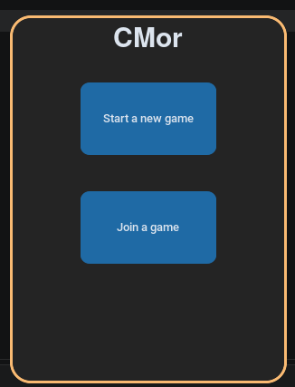
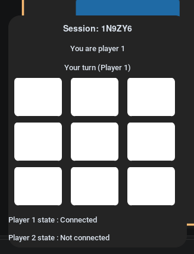

 # CMor
CMor is a 9h Devathon Project we build for fun, is a Morpion in Python with a management server. 

> [!WARNING]
> It will not be updated
# Captures



### Dependecies
#### Server
- Python
- FastAPI
- Uvicorn
#### Client
- Python
- Custom Tkinter
- Tkinter

## Installation
```bash
git clone https://github.com/Akame-Ki/CMor
cd CMor
```
## Server
Start Server: 
```
uvicorn main:app --host 0.0.0.0 --port 8000
```
## Client
Add your local server 
```bash
nano server.json
{
"server" :"http://192.168.1.250:8000"
}
```
Start the game
```bash
python ./menu.py
```


